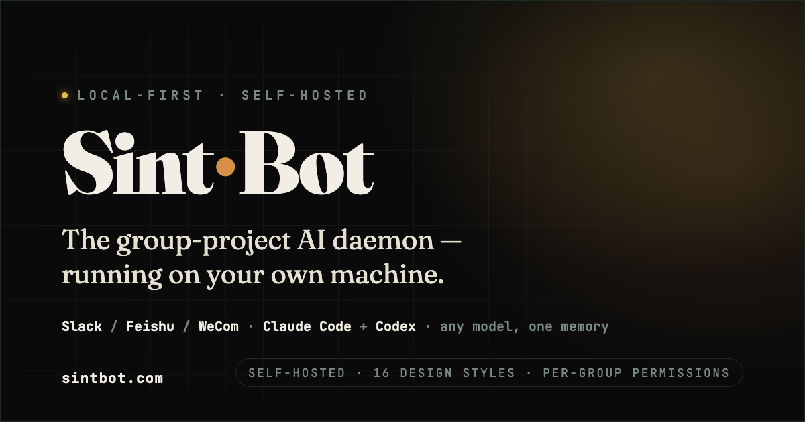
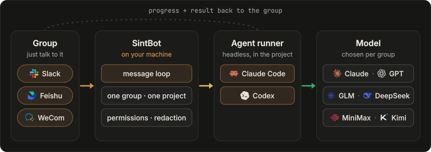

<p align="center">
  <a href="https://sintbot.com"><picture><source srcset="https://raw.githubusercontent.com/sintlab/sintbot/main/docs/assets/hero.svg" type="image/svg+xml"></picture></a>
</p>

<p align="center"><b>Say it in the group. Any model, one memory. On your own machine.</b></p>

<p align="center">
  <a href="https://www.npmjs.com/package/sintbot"></a>
  <a href="https://github.com/sintlab/sintbot/actions/workflows/test.yml"></a>
  
  <a href="./LICENSE"></a>
</p>

<p align="center">
  <a href="https://sintbot.com">Website</a> ·
  <a href="./README.zh-CN.md">简体中文</a> ·
  <a href="./docs/install.md">Install guide</a> ·
  <a href="https://github.com/sintlab/sintbot/releases">Releases</a>
</p>

---

SintBot is a self-hosted daemon that puts a coding agent in your team's group chat. You bind a group to a project directory, and then anyone in that group can hand it work. It reads and changes code, designs, runs scripts and reports back, all on your own machine.

SintBot uses **Claude Code** and **Codex** as agent runners, with tools, MCP servers, skills and project instructions. Each group chooses its runner and model: Claude through Claude Code, GPT through Codex, or GLM, MiniMax, DeepSeek and other compatible endpoints through Claude Code.

SintBot is distributed under the [PolyForm Shield License 1.0.0](./LICENSE).

## How it works

<p align="center"></p>

- **One group, one project.** Each group gets its own project directory, session, queue, permissions and scheduled tasks.
- **Same agent, any brain.** Pick the backend, model and thinking depth with `/model` in the chat. A model or depth change continues the conversation; a backend change starts a new one, while project files and shared notes in `CLAUDE.md` and `AGENTS.md` carry over, so save important decisions in the project first.
- **Stays on your machine.** Projects, sessions, memory and logs live on your disk and never pass through a SintBot server. Prompts and the code the model reads still go to the provider you chose.
- **No public IP.** Every platform uses an outbound long connection (Socket Mode on Slack). One daemon can serve Slack, Feishu and WeCom at the same time.

## Quick start

**1. Install** on macOS with Node.js 22 or newer:

```bash
curl -fsSL https://sintbot.com/install.sh | bash
```

The script checks the environment, installs SintBot and verifies the result, without `sudo`. You can read [install.sh](./install.sh) before running it. Installation does not sign in to a model account, connect a group or start a service.

**2. Connect your group and project.** Run `sintbot start --ui`; the browser opens the local setup page. Enter a project name and scan the QR code with Feishu under an enterprise or team identity: it creates the app, a project folder and a group, then writes the configuration. The [installation guide](https://sintbot.com/guide/install/) covers the options, the manual route and the startup steps.

Installing with an AI assistant? Use the [AI-assisted install and first-use guide](./docs/AI-ASSISTED-INSTALL.md).

**3. @ the bot in your group.** Start with a read-only request: “Read the first line of this project's README and reply with that line.” Then try a concrete task, such as investigating a bug or reviewing a page. See the [usage guide](https://sintbot.com/guide/usage/) for examples.

### Pick a model: no single provider required

The runner handles tools and project work; the model handles reasoning and generation. They are separate choices:

| Runner | Models and providers |
|---|---|
| **Claude Code** | Claude, or GLM, MiniMax, DeepSeek and other Anthropic-compatible endpoints |
| **Codex** | GPT models available through your configured Codex account |

Choose a model for each project and keep durable context in shared project notes. Account requirements, available models and usage limits follow the provider you choose. See [models on the website](https://sintbot.com/#models) for the product overview and the installation guide for setup.

## What you get

| Area | What it does |
|---|---|
| **In the group** | Send tasks, reference images and files in Feishu, Slack or WeCom. Follow progress and receive results in the same project group. |
| **Commands** | Check status, switch models, stop work or start a fresh conversation from the group. See the [usage guide](https://sintbot.com/guide/usage/). |
| **Permissions** | Set permissions per group: read-only, developer or full trust. Configure allowed tools, mask secrets in outgoing messages and choose how personal data is handled. |
| **Scheduled tasks** | Cron, aliases such as `daily`, or plain “every day at 09:00”. A task can wake the agent, post a reminder or run a script, once or on a schedule. |
| **Design** | Work from an existing project style, extract one from references or choose a style preset. Save it in `DESIGN.md`, and iterate through annotations on Feishu whiteboards. |
| **Images** | Generate images, edit existing artwork, repaint a masked region or produce a transparent background. |
| **Previews & browser** | Share interactive HTML prototypes with the team. When a browser task needs sign-in or verification, a group member takes over through a one-time link. |
| **Console** | One local page for groups, projects, models, permissions, plugins, previews, running tasks, queues and live activity. Available in English or Chinese. |
| **Operations** | Manage task limits and concurrency, follow failures and check progress from the console. Preserve task state when investigating an interrupted run. |

## Everyday use

Give the agent a concrete task in the group, just as you would in the terminal:

- “Find the cause of this error and explain it before changing files.”
- “Adjust the homepage for mobile. Keep the current visual style.”
- “Review this change and report any regressions.”
- “Save the decisions and next steps in the project's shared notes.”

The [usage guide](https://sintbot.com/guide/usage/) covers group workflows; the [installation guide](./docs/install.md) contains the executable commands and configuration for the package you install.

## Installation details

This README introduces SintBot's overall product workflow. For installation requirements, supported setup and exact startup instructions, use the [installation guide](./docs/install.md); for release changes, see [Releases](https://github.com/sintlab/sintbot/releases).

“Feishu” means the China edition (open.feishu.cn); international Lark uses a separate platform.

## Security

- The bot **executes commands** on the machine running it. Start with read-only permissions and grant broader access only to groups you trust. A bound project directory is not a shell sandbox.
- Project files, configuration, shared notes and task state stay on your machine. Chat platforms receive messages and replies; model input goes to the provider you choose. Local execution does not mean offline execution.
- Keep credentials out of group messages and repositories. Configure authentication before exposing a management console beyond the local machine.
- Check your model provider's account and team-use terms. If a task's outcome is uncertain, preserve its state and investigate before resending it. Recovery guidance is in the [installation guide](./docs/install.md).

## FAQ

<details>
<summary><b>Do I need a Claude subscription?</b></summary>

No. Claude Code can use compatible model providers such as GLM, MiniMax and DeepSeek; Codex provides the GPT route. Follow the installation guide for the currently distributed setup and the chosen provider’s account requirements.
</details>

<details>
<summary><b>Can I use it in mainland China?</b></summary>

Feishu and providers such as DeepSeek, GLM and MiniMax offer mainland services. Choose the appropriate regional endpoint and check that the machine can reach your chat platform and model provider. The [Chinese website](https://sintbot.com/zh/) has the product introduction and installation instructions.
</details>

<details>
<summary><b>Do I need a server or a public IP?</b></summary>

No. SintBot runs on a computer you keep on; a Mac is the tested setup. It only makes outbound connections: Socket Mode for Slack, a WebSocket long connection for Feishu and a long connection for WeCom. The console stays local unless you open it.
</details>

<details>
<summary><b>Does switching models lose the project's memory?</b></summary>

A switch starts a fresh conversation. Project files and saved shared notes in `CLAUDE.md` and `AGENTS.md` remain available, but the full chat transcript and an agent's private memory are not automatically shared. Save important decisions in the project before switching.
</details>

<details>
<summary><b>How is it different from cc-bot?</b></summary>

Both are free. [cc-bot](https://github.com/WaterTian/cc-bot) is a Claude Code plugin: it runs inside your own interactive session, on that session's model. SintBot is a standalone daemon: each group has its own project, model and permissions, with Claude Code and Codex routes and a local console. Follow the installation guide for how to run the installed package.
</details>

## Documentation

| Topic | Docs |
|---|---|
| Getting started | [Website install guide](https://sintbot.com/guide/install/) · [Repository install guide](./docs/install.md) · [AI-assisted install](./docs/AI-ASSISTED-INSTALL.md) |
| Product and workflows | [Features](https://sintbot.com/#features) · [Models](https://sintbot.com/#models) · [Usage guide](https://sintbot.com/guide/usage/) |
| Project | [Contributing](./CONTRIBUTING.md) · [Security](./SECURITY.md) · [Changelog](./CHANGELOG.en.json) · [Releases](https://github.com/sintlab/sintbot/releases) |

## Feedback

Please report bugs and request features in [GitHub Issues](https://github.com/sintlab/sintbot/issues). Include the following, with secrets redacted:

- the installed version and your OS
- your chat platform and agent runner
- reproduction steps, the expected result and what happened
- relevant error output, with credentials and private project data removed

Report security issues privately through [GitHub Security Advisories](https://github.com/sintlab/sintbot/security/advisories/new); see [SECURITY.md](./SECURITY.md).

## License

SintBot is distributed under the [PolyForm Shield License 1.0.0](./LICENSE) © WaterTian. The package includes a built-in core. The license text governs. Dependency notices are in [THIRD-PARTY-NOTICES.md](./THIRD-PARTY-NOTICES.md).

- You may use, modify and run it for yourself, your team or your company.
- You may not use it to offer a product that competes with SintBot, paid or free.
