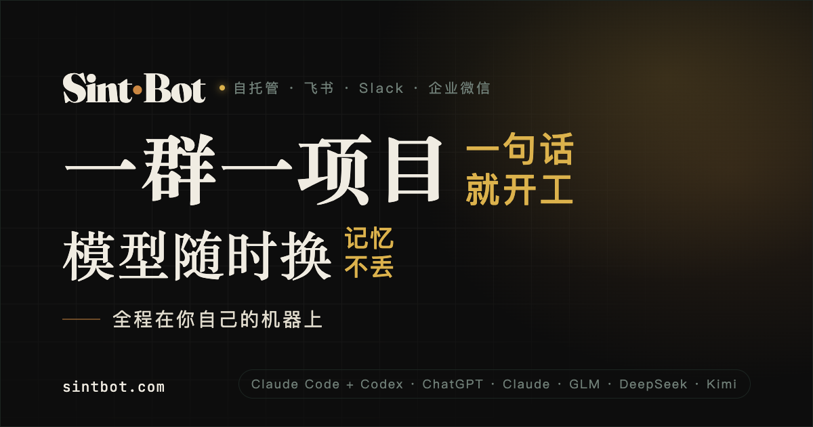
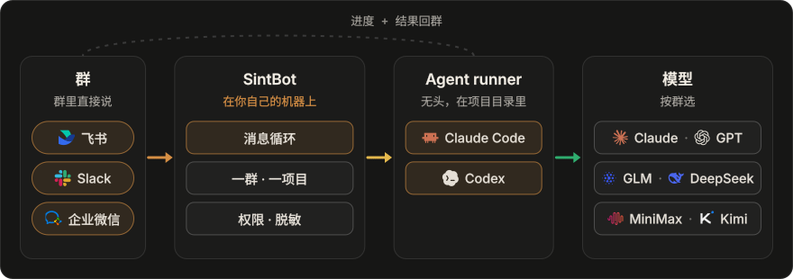

<p align="center">
  <a href="https://sintbot.com/zh/"><picture><source srcset="https://raw.githubusercontent.com/sintlab/sintbot/main/docs/assets/hero-zh.svg" type="image/svg+xml"></picture></a>
</p>

<p align="center"><b>一群一项目,一句话就开工;模型随时换,记忆不丢;全程在你自己的机器上。</b></p>

<p align="center">
  <a href="https://www.npmjs.com/package/sintbot"></a>
  <a href="https://github.com/sintlab/sintbot/actions/workflows/test.yml"></a>
  
  <a href="./LICENSE"></a>
</p>

<p align="center">
  <a href="https://sintbot.com/zh/">官网</a> ·
  <a href="./README.md">English</a> ·
  <a href="./docs/zh-CN/install.md">安装说明</a> ·
  <a href="https://github.com/sintlab/sintbot/releases">版本发布</a>
</p>

---

SintBot 是一个跑在你自己机器上的守护进程,把能写代码的 AI 放进团队的聊天群。一个群绑一个项目目录,群里谁都能派活。它会读代码、改代码、做设计、跑脚本、回报结果,全程在你自己的机器上。

SintBot 通过 **Claude Code** 或 **Codex** 执行项目任务，接入工具、MCP、skills 和项目说明。执行器与模型按群选择：Claude Code 可使用 Claude，也可接 GLM、MiniMax、DeepSeek 等兼容服务；Codex 对应 GPT 模型。

SintBot 按 [PolyForm Shield 1.0.0 许可](./LICENSE) 分发。

## 怎么跑

<p align="center"></p>

- **一群一项目。** 每个群各有自己的项目目录、会话、排队、权限和定时任务。
- **同一套 agent,任意大脑。** 群里发 `/model` 点选后端、型号和思考深度。换型号或调深度接着当前对话；换后端会开新对话，项目文件及 `CLAUDE.md`、`AGENTS.md` 中的共享记录可以延续，重要决定先写进项目。
- **数据留在本机。** 项目、会话、记忆、日志都在你自己的硬盘上,不经过任何 SintBot 服务器。提示词和模型读到的代码照常发给你选的模型服务商。
- **不要公网 IP。** 每个平台都是机器主动往外连的长连接(Slack 用 Socket Mode)。一个守护进程可以同时接飞书、Slack、企业微信。

## 快速开始

**1. 安装**，需要 macOS 和 Node.js 22 及以上：

```bash
curl -fsSL https://sintbot.com/install.sh | bash
```

脚本会检查环境、安装 SintBot 并验证结果，不用 `sudo`。也可以先读 [install.sh](./install.sh)。安装本身不登录模型账号、不连接群，也不启动服务。

**2. 接入群和项目。** 运行 `sintbot connect`，用企业/团队身份的飞书扫码：它会创建应用、项目目录和群，并写好配置。参数、手动路径和启动步骤见[安装指南](https://sintbot.com/zh/guide/install/)。

想让本机 AI 助手帮忙安装并完成首次使用？先看 [AI 安装与首次使用说明](./docs/zh-CN/AI-ASSISTED-INSTALL.md)。

**3. 在群里 @ 机器人。** 先发一条只读请求：“读取这个项目 README 的第一行，只回复这一行。”再尝试排查问题、检查页面等具体任务，更多示例见[使用说明](https://sintbot.com/zh/guide/usage/)。

### 选模型：不绑定单一服务商

执行器负责调用工具、处理项目，模型负责理解与生成，两者分开选择：

| 执行器 | 模型与服务 |
|---|---|
| **Claude Code** | Claude，或 GLM、MiniMax、DeepSeek 等 Anthropic 兼容端点 |
| **Codex** | 通过已配置的 Codex 账号使用 GPT 模型 |

按项目选择模型，把需要长期保留的上下文写进共享项目记录。账号要求、可用模型与额度以所选服务商为准。产品介绍见[官网模型说明](https://sintbot.com/zh/#models)，实际接入步骤见安装指南。

### 在中国大陆

- **聊天平台可选飞书。**
- **模型服务**可选 DeepSeek、智谱 GLM、MiniMax 等国内站点；按账号选择对应区域的端点，确认本机能访问所用平台和模型服务。
- **GitHub 打不开**：中文介绍、安装步骤和使用说明在[官网](https://sintbot.com/zh/)上都有。

## 能做什么

| 方面 | 说明 |
|---|---|
| **群里** | 在飞书、Slack 或企业微信里发任务、参考图和文件，查看进度，在同一个项目群里接收结果。 |
| **命令** | 在群里查看状态、切换模型、停止任务或开启新对话，使用方式见[使用说明](https://sintbot.com/zh/guide/usage/)。 |
| **权限** | 按群选择只读、开发或全信任权限，配置允许的工具。消息发出前遮盖密钥，个人信息的处理方式按群设置。 |
| **定时任务** | cron、`daily` 这类别名，或直接写“每天 09:00”。到点可以叫醒 agent、只发提醒，或只跑一个脚本，支持一次性和周期任务。 |
| **设计** | 沿用现有项目风格，从参考素材提炼风格，或选择风格预设。保存为 `DESIGN.md`，在飞书画板上标注、迭代。 |
| **生图** | 生成图片、修改原图、遮罩局部重绘或输出透明底素材。 |
| **预览与浏览器** | 把可交互的 HTML 原型分享给团队。浏览器任务遇到登录或验证时，群成员通过一次性入口接管。 |
| **控制台** | 一个本地网页管理群、项目、模型、权限、插件、预览、运行任务、消息队列与实时活动，支持中英文。 |
| **运维** | 管理任务时限与并发，在控制台查看失败原因和任务进展；排查中断任务时保留现场状态。 |

## 日常使用

像在终端里一样，在群里交代具体任务：

- “找到这个报错的原因，先解释，再修改。”
- “调整首页手机布局，沿用现在的视觉风格。”
- “审查这次改动，指出可能引入的问题。”
- “把决定和下一步写进项目的共享记录。”

群内工作方式见[使用说明](https://sintbot.com/zh/guide/usage/)；当前安装包可执行的命令和配置见[安装指南](./docs/zh-CN/install.md)。

## 安装说明

本 README 介绍 SintBot 的整体产品与工作方式。安装环境、支持的接入方式及准确启动步骤见[安装指南](./docs/zh-CN/install.md)，发行变更见[版本发布](https://github.com/sintlab/sintbot/releases)。

这里的飞书指中国版（open.feishu.cn）；国际版 Lark 使用另一套开放平台。

## 安全须知

- 机器人能在运行它的机器上**执行命令**。先从只读权限开始，更高权限只给信任的群。绑定项目目录不等于为命令行提供沙箱。
- 项目文件、配置、共享记录和任务状态保存在本机。聊天平台接收消息与回复，模型输入发送到所选服务商；本机执行不等于离线运行。
- 不要把凭据发进群或提交到仓库。将管理控制台开放给本机以外的访问前，应配置身份验证。
- 团队使用前核对模型服务商的账号条款。任务结果不明确时，保留状态并查清后再重发，恢复说明见[安装指南](./docs/zh-CN/install.md)。

## 常见问题

<details>
<summary><b>必须有 Claude 订阅吗?</b></summary>

不需要绑定 Claude。Claude Code 可接入 GLM、MiniMax、DeepSeek 等兼容服务，Codex 对应 GPT 路线。当前安装包的接入方式按安装指南操作，账号要求以所选服务商为准。
</details>

<details>
<summary><b>在中国大陆能用吗?</b></summary>

飞书及 DeepSeek、GLM、MiniMax 等服务有国内站点。按账号选择对应区域的端点，并确认本机能访问所用的聊天平台和模型服务。中文介绍与安装步骤也可以直接在官网查看。
</details>

<details>
<summary><b>需要服务器或公网 IP 吗?</b></summary>

不需要。它跑在一台你一直开着的电脑上(Mac 是验证过的环境),只向外连接:飞书用 WebSocket 长连接,Slack 用 Socket Mode,企业微信用长连接。控制台默认只在本机,除非你自己选择开放。
</details>

<details>
<summary><b>换模型会丢掉项目记忆吗?</b></summary>

换模型会开一段新对话，项目文件及 `CLAUDE.md`、`AGENTS.md` 中保存的共享记录仍然可用，但完整聊天记录和各执行器的私有记忆不会自动互通。需要延续的决定先写进项目。
</details>

<details>
<summary><b>它和 cc-bot 有什么区别?</b></summary>

两者都免费。[cc-bot](https://github.com/WaterTian/cc-bot) 是 Claude Code 插件,运行在你自己的交互会话里,用的就是该会话的模型。SintBot 是独立的守护进程:每个群有自己的项目、模型和权限，提供 Claude Code、Codex 两条执行路线，并有本地控制台。当前安装包如何运行，以安装指南为准。
</details>

## 文档

| 主题 | 文档 |
|---|---|
| 上手 | [官网安装指南](https://sintbot.com/zh/guide/install/) · [仓库安装指南](./docs/zh-CN/install.md) · [AI 辅助安装](./docs/zh-CN/AI-ASSISTED-INSTALL.md) |
| 产品与工作方式 | [功能介绍](https://sintbot.com/zh/#features) · [模型说明](https://sintbot.com/zh/#models) · [使用说明](https://sintbot.com/zh/guide/usage/) |
| 项目 | [参与开发](./CONTRIBUTING.zh-CN.md) · [安全](./SECURITY.zh-CN.md) · [更新日志](./CHANGELOG.json) · [版本发布](https://github.com/sintlab/sintbot/releases) |

## 反馈

碰到问题或想要新功能,请到 [GitHub Issues](https://github.com/sintlab/sintbot/issues) 提。请附上以下信息,贴之前先遮掉密钥:

- 安装版本与操作系统
- 聊天平台与执行器
- 复现步骤、预期结果和实际情况
- 相关报错输出，去除凭据与私有项目数据

安全问题请通过 [GitHub 私密漏洞报告](https://github.com/sintlab/sintbot/security/advisories/new)私下提交,别发公开 issue,详见 [SECURITY.md](./SECURITY.zh-CN.md)。

## 许可

SintBot 按 [PolyForm Shield 1.0.0 许可](./LICENSE) 分发，© WaterTian。安装包包含内置核心，准确边界以许可原文为准；依赖声明见 [THIRD-PARTY-NOTICES.md](./THIRD-PARTY-NOTICES.md)。

- 可以自己用、团队或公司内部用,也可以修改和运行。
- 不可以拿它做成与 SintBot 竞争的产品,收费、免费都不行。
